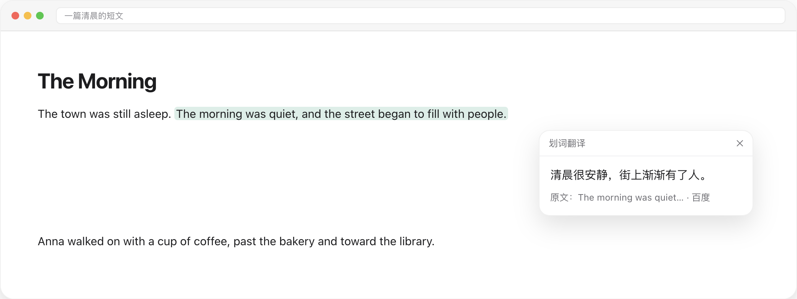
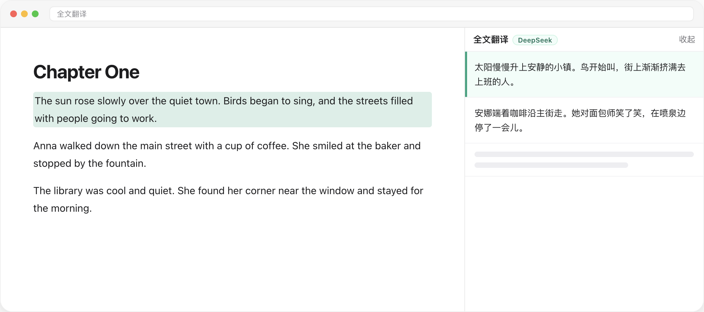
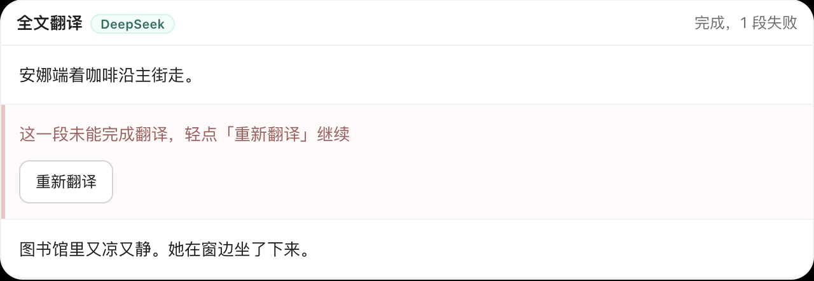

# 划词翻译

这是一个 Chrome 浏览器划词翻译插件。选中网页里的文字，译成中文。短句停在选区旁边，长文在页面右侧展开。某一段没有译成时，可以只重译这一段。支持百度翻译 API 与 DeepSeek。

短句停在选区旁边。



长文在右侧展开，点一段，原文和译文会对上。



没译成的那一段留在原地，可以只重译这一段。



这是一个 Chrome 扩展（Manifest V3）。密钥由每位使用者自己申请，只保存在自己的浏览器里。仓库中没有任何密钥。

图文介绍：<https://recmutzl.github.io/huaci-translate/>（源文件在 [docs/index.html](docs/index.html)）

## 安装

1. 下载本仓库并解压。
2. 打开 Chrome，地址栏输入 `chrome://extensions/`。
3. 打开右上角的「开发者模式」。
4. 点「加载未打包的扩展程序」。
5. 选中解压目录里的 `huaci-translate` 文件夹。选文件夹本身，不要选里面的单个文件。

代码更新后，在扩展卡片上点刷新，并重新加载正在看的网页。

仓库里的 `test-full.html` 是一篇英文样例，可以用来试长文侧窗。

## 打开设置

扩展没有工具栏弹出页。设置从扩展详情进入：

1. 打开 `chrome://extensions/`，找到「划词翻译」。
2. 点「详细信息」，再点「扩展程序选项」。
3. 「启用插件」是总开关。「选中后自动翻译」默认开启；关掉后，选中文字会先出现「翻译」按钮。
4. 选择翻译引擎，填入该引擎要求的 ID 或密钥。
5. 点「保存设置」，再点「测试翻译」。能看到中文译文，说明配置可用。

请只在设置页填写自己的密钥。不要把密钥写进源码、截图或议题里。

## 申请百度翻译 API

短句翻译可以使用百度通用文本翻译 API 的标准版。标准版有免费额度。

1. 打开 [百度翻译开放平台](https://fanyi-api.baidu.com/)，用百度账号登录。
2. 开通「通用文本翻译 API」，选择标准版。
3. 按提示创建应用。应用名称可以填写「划词翻译」。
4. 进入管理控制台的「开发者信息」，复制 **APP ID** 和 **密钥**。
5. 在插件设置中把引擎选为「百度翻译」，分别填入这两项，保存，然后点「测试翻译」。

使用时请注意：

- 标准版大约每秒只能请求一次。连续快速选词时如果提示访问频率受限，稍等再试。
- 如果提示 IP 不在白名单，到管理控制台的应用管理中，把当前电脑的公网 IP 加入该应用的白名单。
- 签名错误或认证失败，通常是 APP ID 或密钥复制得不完整，请重新粘贴后再测。

开放平台的页面名称如果和上面略有差别，以百度页面上的当前文案为准。

## 长文使用 DeepSeek

右侧全文侧窗固定使用 DeepSeek，以便分段翻译，也不占用百度每秒一次的限额。只使用短句翻译时，可以只配置百度。

1. 打开 [DeepSeek 开放平台](https://platform.deepseek.com/) 并登录。
2. 在 API Keys 中创建密钥。密钥通常只显示一次，请自行保存。
3. 在插件设置里先把引擎切换为 DeepSeek，密钥输入框才会出现。填入后保存。
4. 如果短句仍想使用百度，可以再把引擎切回百度。已保存的 DeepSeek 密钥会保留，长文继续使用它。

费用按 DeepSeek 的实际价格计算。请以官网当前价格为准。

## 使用

- 选中不超过 500 字的外文，松开鼠标后，译文出现在选区附近。
- 选中内容以中文为主时，不会触发翻译。
- 选中超过 500 字，或按 `Cmd/Ctrl + A`，打开右侧全文侧窗。侧窗只显示中文。
- 点原文或译文的某一段，两侧会高亮并滚到对应位置。鼠标只是划过译文时，不高亮页面。
- 侧窗左缘可以拖动，最宽为页面宽度的一半。
- 点页面空白处或按 `Esc`，侧窗收成右侧的「译」字圆球。点圆球可以恢复，不会重新翻译。
- 某一段失败时，会显示「这一段未能完成翻译，轻点「重新翻译」继续」。只重译这一段。
- 短句弹层在点到外面或按 `Esc` 时关闭。滚动页面时，弹层跟随选区。

## 隐私

选中的文字会发送到你配置的百度或 DeepSeek 服务器，用于生成译文。API 密钥保存在本机 `chrome.storage`，不会进入本仓库，也没有插件作者的服务器接收它。

在网银、邮箱、病历等页面，建议先在设置里关闭插件。

## 目录

```
huaci-translate/     扩展源码
docs/index.html      图文介绍
test-full.html       长文试用页
```

## 许可

[MIT](LICENSE)
